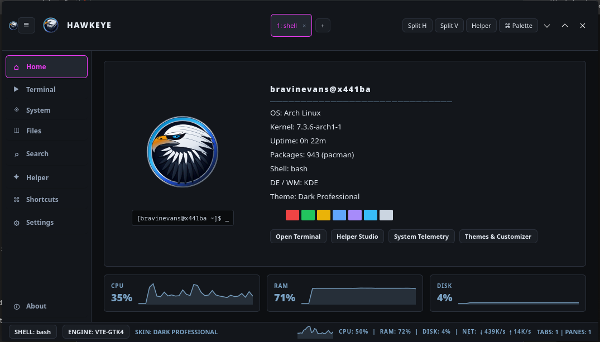

# HAWKEYE — SEE MORE. DO MORE.

Native GTK4 + VTE terminal environment engineered for Arch Linux.

## Features
- **Six Master Visual Identities + Custom Theme Studio**: Dark Professional, Cyberpunk Neon, Amber Tactical, Dracula Inspired, Light Modern, and Matrix Terminal — plus live color pickers, transparency, corner radius, and custom skin saving.
- **Multi-Tab & Recursive Split Workspace**: Open tabs (Ctrl+Shift+T), split horizontally/vertically (Ctrl+Shift+D / Ctrl+Shift+E), close panes (Ctrl+Shift+X), search scrollback (Ctrl+Shift+F), drag-and-drop paths, and restore sessions across restarts.
- **Home Hero & Live System Telemetry**: Hawk emblem, neofetch-style system summary, ANSI palette bar, and live Cairo sparklines for CPU, RAM, Disk, and Network I/O.
- **BYOK Helper Studio & Drawer**: Connect your own OpenRouter, Groq, Google Gemini, OpenAI, or local Ollama endpoint to write code, edit files, and inject commands directly into your shell.

## Run Locally
    python3 main.py

## Install System-Wide on Arch Linux
    cd packaging
    makepkg -si
